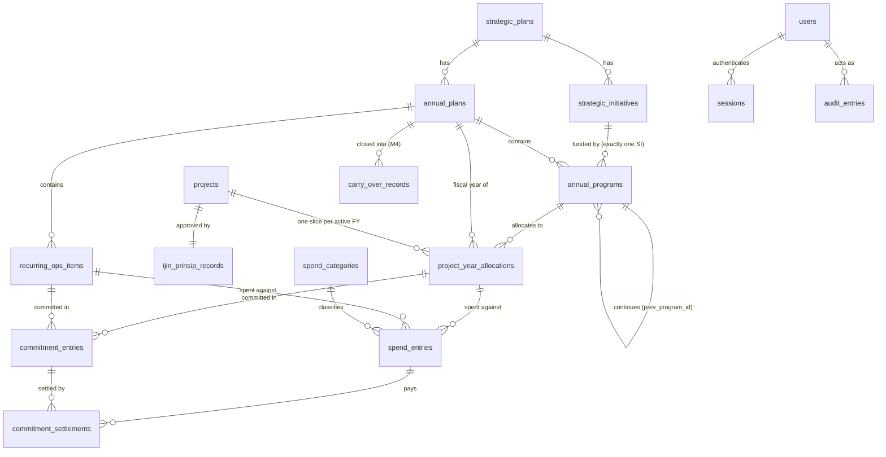

# Data model

Source of truth for the Strapla schema. Implemented in `src/db/schema.ts` with Drizzle migrations under `drizzle/`. Domain rules that *use* this data are in `src/domain` and are specified in [ADR-0003](adr/0003-funding-and-settlement.md); vocabulary is in [GLOSSARY.md](../GLOSSARY.md).

Conventions: UUID primary keys (`gen_random_uuid()`), `timestamptz` timestamps written in UTC and displayed in Asia/Jakarta, money as `bigint` whole Rupiah ≥ 0, `date` for business dates, `created_by`/`updated_by` user references on every mutable financial record, soft cancellation through `voided_at` + `voided_reason` (never `DELETE`). Every mutation also writes an `audit_entries` row in the same transaction ([ADR-0004](adr/0004-audit-and-roles.md)).

## ERD

New in-insight tables vs charter v0.1: `commitment_settlements` (E11), `audit_entries` (E12), `spend_categories` (E13). Opening balances (E14) are columns on `strategic_initiatives`, `annual_programs`, `project_year_allocations` and `projects` (see “Opening balances”).

## Enumerations

| Enum | Values |
| --- | --- |
| `strategic_plan_status` | `draft`, `active`, `archived` |
| `annual_plan_status` | `draft`, `active`, `closed` |
| `project_status` | `active`, `cancelled` |
| `component` | `capex`, `opex` |
| `settlement_kind` | `current`, `prior_year_opening` (cross-year in-app settlements are derived, not stored) |
| `carry_over_level` (M4) | `program`, `project_allocation` |

Derived, never stored: commitment lifecycle (`open` when settled = 0, `partially_settled` when 0 < settled < amount, `settled` when settled = amount; `voided` excludes it), remaining, unallocated budget, all flags.

## Tables

### Identity and audit

| Table | Key columns | Notes |
| --- | --- | --- |
| `users` | `id`, `email` (unique, lower-cased), `name`, `password_hash`, `is_active`, `created_by`, timestamps | Every user is an administrator ([ADR-0004](adr/0004-audit-and-roles.md)). Never deleted. |
| `sessions` | `id`, `user_id`, `token_hash` (unique), `expires_at`, `last_seen_at`, `revoked_at`, `created_at` | Only the SHA-256 of the cookie token is stored. |
| `audit_entries` | `id`, `actor_user_id`, `action`, `entity_type`, `entity_id`, `before` jsonb, `after` jsonb, `reason`, `created_at` | Append-only. Indexed by `(entity_type, entity_id, created_at)` and `(created_at)`. |
| `spend_categories` | `id`, `name` (unique), `sort_order`, `is_active`, timestamps | Administrator-managed reference data; deactivated, never deleted. |

### Plan

| Table | Key columns | Notes |
| --- | --- | --- |
| `strategic_plans` | `id`, `name`, `start_fiscal_year`, `end_fiscal_year`, `status`, timestamps | At most one `active` plan and one `draft` plan at a time (enforced in domain + partial unique index). |
| `strategic_initiatives` | `id`, `plan_id`, `code`, `name`, `owner`, `objective`, `envelope_amount`, `prior_program_budget_used`, `notes`, void/timestamps | Unique `(plan_id, code)`. `prior_program_budget_used` is the opening-balance layer for the envelope check. |
| `annual_plans` | `id`, `plan_id`, `fiscal_year` (unique), `status`, `closed_at`, `closed_by`, `notes`, timestamps | One per fiscal year (BR-3). Status changes and close are audited. |
| `annual_programs` | `id`, `annual_plan_id`, `si_id`, `prev_program_id` (self FK), `code`, `name`, `capex_budget`, `opex_budget`, `carry_in_capex`, `carry_in_opex`, `notes`, void/timestamps | Unique `(annual_plan_id, code)`. `prev_program_id` is the program continuation link (program thread). Carry-in comes from the prior year's close (or manual FY2026 close). |

### Projects and annual slices

| Table | Key columns | Notes |
| --- | --- | --- |
| `projects` | `id`, `originating_program_id`, `code` (unique, generated `PRJ-<FY>-<nnn>`), `external_reference`, `name`, `description`, `owner`, `start_fiscal_year`, `end_fiscal_year`, `status`, `cancelled_reason`, `allocated_budget_full_life`, `submitted_price`, `final_deal_price`, `opening_allocated`, `opening_committed`, `opening_spent`, void/timestamps | Created once, never duplicated per year (BR-5). `final_deal_price` is the contract value. Approved budget is derived from `ijin_prinsip_records`. |
| `ijin_prinsip_records` | `id`, `project_id` (unique), `document_number`, `document_date`, `approved_amount`, `approver`, `document_url`, `notes`, timestamps | Exactly one active record per project (charter v0.2 §11 Q2). Edits are audited. `document_url` is the "document link" (no uploads). |
| `project_year_allocations` | `id`, `project_id`, `annual_plan_id`, `annual_program_id`, `allocation_capex`, `allocation_opex`, `carry_in_capex`, `carry_in_opex`, `notes`, void/timestamps | Unique `(project_id, annual_plan_id)`; the annual slice (E6). Program's SI must equal the project's originating program's SI (BR-6, domain check). |
| `recurring_ops_items` | `id`, `annual_plan_id`, `name`, `category_id`, `owner`, `opex_budget`, `carry_in_opex`, `notes`, void/timestamps | Opex-only, no SI, no projects (BR-12). Its budget is the ceiling; there is no contract value. |

### Commitments, spend, settlement

| Table | Key columns | Notes |
| --- | --- | --- |
| `commitment_entries` | `id`, `project_year_allocation_id` xor `recurring_ops_item_id`, `component`, `amount`, `commitment_date`, `reference`, `description`, void/timestamps | CHECK exactly one parent; recurring ops parent requires `component = 'opex'`. No stored status: derived from settlements. |
| `spend_entries` | `id`, `project_year_allocation_id` xor `recurring_ops_item_id`, `component`, `amount`, `spent_on`, `category_id`, `vendor`, `reference`, `description`, `settlement_kind`, void/timestamps | CHECK exactly one parent; recurring ops parent requires opex. `prior_year_opening` marks money paying pre-FY2027 commitments ([ADR-0003](adr/0003-funding-and-settlement.md) §4). |
| `commitment_settlements` | `id`, `spend_entry_id`, `commitment_entry_id`, `amount`, `created_by`, `created_at` | Unique `(spend_entry_id, commitment_entry_id)`; partial settlement via repeated updates (audited) or multiple rows. Sum per commitment ≤ commitment amount; sum per spend ≤ spend amount. Settlement is a lifecycle event and may happen after year close. |
| `carry_over_entries` (M4) | `id`, `source_annual_plan_id`, `target_annual_plan_id`, `entity_type` (`program` or `allocation`), `source_entity_id`, `target_entity_id`, `component`, `amount`, `approval_reference`, `created_by`, `created_at` | Explicit carry-over at year close (BR-13); unique per source entity/component. The target's `carry_in_*` is added when the close completes. The snapshot is append-only; `annual_plans` gains `close_reference` plus `closed_at`/`closed_by`. |

## Opening balances

The app's first in-app fiscal year is FY2027; FY2026 is closed manually outside the app. Pre-app data enters as opening figures, never as reconstructed records:

| Where | Column(s) | Meaning |
| --- | --- | --- |
| `strategic_initiatives` | `prior_program_budget_used` | Program budgets already consumed before FY2027 (SI envelope check) |
| `annual_programs` (FY2027) | `carry_in_capex`, `carry_in_opex` | Program budget carried forward from the manual FY2026 close |
| `project_year_allocations` (FY2027) | `carry_in_capex`, `carry_in_opex` | Project allocation carried forward |
| `projects` | `opening_allocated`, `opening_committed`, `opening_spent` | Lifetime figures before the app: allocated, still-open commitments, actual spend |

Only projects with an allocation in an in-app fiscal year can receive in-app spend and commitments; legacy projects that ended before FY2027 are not modelled inside the app.

## Custom fields (issue #46)

One deployment is one organisation (G5), so the field registry is a deployment-level configuration, not
a tenant dimension.

| Table | Holds |
| --- | --- |
| `custom_fields` | The administrator-defined registry: entity type, name, stable machine `key` (derived once from the name; the W9 field list's identifier), type (`text`, `number`, `date`), required flag, description, optional example value, administrator-controlled `position`, archive state and the audit references. Active names and keys are unique per entity; archiving frees both. |
| `custom_field_values` | One row per record that has extra values, keyed by entity type and record id, holding one JSON object keyed by **field id** (so renaming a field never rewrites recorded data). |

- Supported entities: `strategic_initiative`, `annual_program`, `project`, `recurring_ops_item`, and (#71) `ijin_prinsip`, `project_year_allocation`, `commitment_entry`, `spend_entry`. The strategic plan and annual plan are deliberately out: one record each, with no per-record variance to capture. The opening import covers SIs, programs and projects only, so the four added records are entered through their own forms.
- Values are parsed and validated by type in `src/domain/custom-fields.ts`; the forms, record panels,
  reports, exports and the opening-import parser (for registry columns) all use that module, so the
  surfaces cannot drift.
- Create, edit, remove, restore and reorder are audited (`custom_field_create`,
  `custom_field_update`, `custom_field_remove`, `custom_field_restore`, `custom_field_reorder`). Removal follows the no-delete convention: the
  definition is archived (`archived_at` + `archived_reason`), the field leaves every surface, and its
  recorded values are kept (values for an archived field are preserved when the record is edited).
  The audit `before` snapshot records the values that were held. The audit view labels the five
  custom-field actions (create, update, remove, restore, reorder) and the `custom_field` entity in
  words while keeping the machine tokens as filter values, so a saved audit link still filters the
  same rows.
- Administration → Custom fields shows every active field's stable key and how many records hold a
  value for it (the remove confirmation repeats the count); the archived list shows the key, type,
  archive date, reason and how many records still hold a value. Restoring (with a reason) clears the
  archive state and writes `custom_field_restore`; because values are keyed by field id, the recorded values show
  again on forms, record panels, reports and exports. A restore is refused while an active field on
  the same entity uses the name or the key.
- Field order is administrator-controlled (#73): `position` is one sequence per entity type, new
  fields append at the end, archived fields drop out of every registry read, and the one ordered
  read feeds the administration list, create/edit forms, record panels, report columns and export
  checkboxes. A reorder swaps two positions and writes a `custom_field_reorder` audit entry
  (actor, field, from/to position); it is a reversible display preference, so it needs no reason.
- The `required` flag is enforced when a record is saved through the app forms. The opening import
  reads the registry too: a row that does not supply a required field fails with its line number,
  and nothing is written, so every imported record stays editable. The parsed row keeps the field's
  stable key and the value is stored under the field id in the same transaction; a display name that
  repeats an app-owned column header gets ` (custom field)` appended for that import column.
- A created or updated record audits the extra values together with the record (`customFields` in the
  before/after snapshot), including the records created by the opening import.
- Custom fields never change `remaining`, flags, allocations or any existing report total (G1).
  Reports add them as extra columns. A report accepts more than one custom-field filter (repeated
  `cf`/`cv` parameters, combined with AND) shown as removable chips, and remembers each user's
  custom-column selection in `report_preferences` (#74, #75): the report and its export checkboxes
  default to the saved selection, while an explicit `columns` parameter always wins for shareable
  links. Filters and the remembered selection never change totals or the full-report export.
- **Forward-only migration:** `0006` adds the two tables and seeds the W9 owner column
  (`project` / `Procurement method`, key `procurementMethod`) from the December field list.
  Existing financial tables are untouched. From then on the registry is the runtime source of truth for record forms, record
  panels, reports, exports and the opening import; the headless opening-import tooling keeps its
  committed field list. `0007` adds the optional `example` column, a display hint for the
  administration row and the opening-import template example; it is never stored on a record.
  `0008` (#71, #73, #75) extends the entity-type checks to the four added records, adds the
  `position` column and backfills one sequence per entity from creation order, and adds
  `report_preferences` (one custom-column selection per user and report).

## Invariants

Domain functions in `src/domain` implement these; database constraints block the ones that can be structural. Tests reference the `INV` ids.

| ID | Invariant |
| --- | --- |
| INV-1 | All amounts are integers ≥ 0 and safe in JS number arithmetic. |
| INV-2 | A spend entry and a commitment entry each have exactly one parent: a project year allocation or a recurring ops item. |
| INV-3 | Recurring ops parents only accept `component = 'opex'`. |
| INV-4 | Sum of commitment amounts (not voided) per project year allocation, plus other commitments of the same project across years, may exceed contract value only with a flag (BR-8, never blocks). |
| INV-5 | Settlement per commitment ≤ commitment amount; settlement per spend entry ≤ spend amount. |
| INV-6 | `remaining = allocation + carry_in − open commitments − current-year spend`, per component, where cross-year settlements and `prior_year_opening` spends are excluded from current-year spend. |
| INV-7 | Program unallocated = `budget + carry_in − allocated`, per component; allocations exceeding available are flagged (BR-7). |
| INV-8 | SI envelope check = `prior_program_budget_used + Σ program budgets (in-app) ≤ envelope`; exceeding is flagged (BR-2). |
| INV-9 | One annual plan per fiscal year; plans exist only within the strategic plan horizon (BR-1, BR-3). |
| INV-10 | One project year allocation per project per active fiscal year; its program's SI must match the project's originating SI (BR-6). |
| INV-11 | A fiscal year that is `closed` blocks mutations except audited administrator corrections and settlement lifecycle events. |
| INV-12 | Financial records are never hard-deleted; void requires a reason and an audit entry. |
| INV-13 | Every mutation writes exactly one audit entry in the same transaction. |
| INV-14 | Carry-over amounts require an approval reference and are per component (BR-13). |

## Report catalogue (figures come from `src/domain`)

| Report | Level | Figures |
| --- | --- | --- |
| SI five-year view | SI | Envelope, prior consumed, cumulative program budget, allocations, commitments, spend, remaining headroom, per component + combined |
| Annual plan | SI → program | Budget, carry-in, allocated, unallocated, commitments, spend, flags |
| Project register | project → allocation | Full-life figures (allocated, approved, submitted, final), per-year allocation/commitments/spend, lifetime committed/spent, flags |
| Budget versus actual | portfolio/SI/program/project/year | Budget, commitments, spend, cross-year settlements line, remaining, per component + combined |
| Over-budget flags | all levels | The seven flags in ADR-0003 §6 |

All reports export as CSV/XLSX and have a print-friendly route. Custom fields appear as extra
columns on screen and in the export when selected. Multiple custom-field filters narrow the rows on
screen, combined with AND and removable one at a time; the totals and the export always cover the
whole report. Each user's custom-column selection is remembered per report (an explicit `columns`
link still wins).
