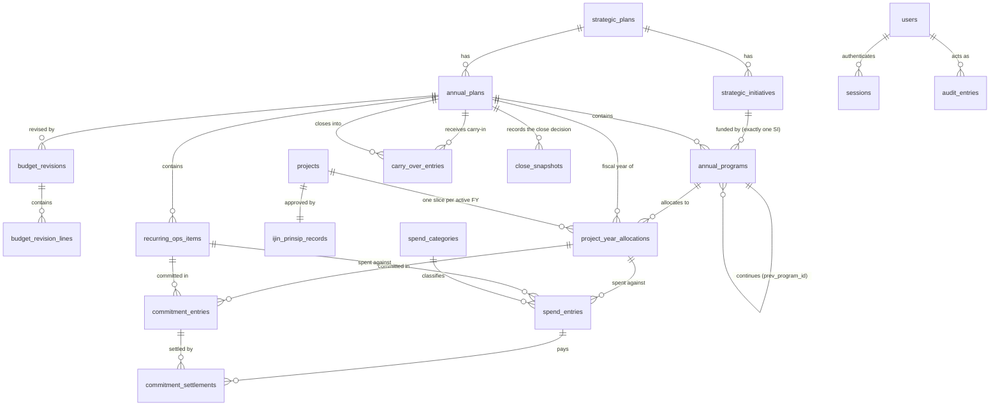

# Data model

Source of truth for the Strapla schema. Implemented in `src/db/schema.ts` with Drizzle migrations under `drizzle/`. Domain rules that *use* this data are in `src/domain` and are specified in [ADR-0003](adr/0003-funding-and-settlement.md); vocabulary is in [GLOSSARY.md](../GLOSSARY.md).

Conventions: UUID primary keys (`gen_random_uuid()`), `timestamptz` timestamps written in UTC and displayed in Asia/Jakarta, money as `bigint` whole Rupiah ≥ 0, `date` for business dates, `created_by`/`updated_by` user references on every mutable financial record, soft cancellation through `voided_at` + `voided_reason` (never `DELETE`). Every mutation also writes an `audit_entries` row in the same transaction ([ADR-0004](adr/0004-audit-and-roles.md)).

## ERD

New in-insight tables vs charter v0.1: `commitment_settlements` (E11), `audit_entries` (E12), `spend_categories` (E13), `budget_revisions` / `budget_revision_lines` (ADR-0006 §4), and `carry_over_entries` / `close_snapshots` (ADR-0006 §2–3). Opening balances (E14) are columns on `strategic_initiatives`, `annual_programs`, `project_year_allocations` and `projects`, plus the control-total row in `opening_balance_reconciliations` (see “Opening balances”).

## Enumerations

| Enum | Values |
| --- | --- |
| `strategic_plan_status` | `draft`, `active`, `archived` |
| `annual_plan_status` | `draft`, `active`, `closed` |
| `project_status` | `active`, `cancelled` |
| `component` | `capex`, `opex` |
| `settlement_kind` | `current`, `prior_year_opening` (cross-year in-app settlements are derived, not stored) |
| `budget_revision_entity_type` | `program`, `allocation` (a revision line names the entity it changes) |
| `carry_over_entity_type` | `program`, `allocation` (the receiving entity of a ledger receipt, or the source entity of a close snapshot) |
| `carry_over_origin` | `close` (written by a year close), `opening` (the one-time opening-balance backfill) or `manual` (a reasoned grant) |

Derived, never stored: effective program budget (initial + Σ posted revision deltas), effective allocation (initial + Σ posted de-allocation deltas), **carry-in for programs and allocations (Σ ledger receipts per entity and component)**, commitment lifecycle (`open` when settled = 0, `partially_settled` when 0 < settled < amount, `settled` when settled = amount; `voided` excludes it), remaining, unallocated budget, all flags. The `carry_in_capex` / `carry_in_opex` columns on programs and allocations are a **guarded cache**, not an independent input: the ledger service is their only writer and keeps them equal to the receipt sum. A recurring ops item's `carry_in_opex` is not part of that ledger: it is a typed in-place input (ADR-0006 §7), so it is corrected with the item in a closed year (ADR-0007 §2). **Corrected after close** is derived as well: it is the presence of a `correction` entry in `audit_entries` for that entity (ADR-0007 §6). A correction adds no column and no table — it is an in-place update of an existing plan record, audited under `correction` instead of `update`, and it never writes `close_snapshots`, `carry_over_entries` or the ledger-backed `carry_in_*` caches on programs and allocations. The archived date and reason of an archived strategic plan are derived the same way: from the `status_change` audit entry whose `after->>'status' = 'archived'` (ADR-0008 §8), with no column on the plan row.

## Tables

### Identity and audit

| Table | Key columns | Notes |
| --- | --- | --- |
| `users` | `id`, `email` (unique, lower-cased), `name`, `password_hash`, `is_active`, `created_by`, timestamps | Every user is an administrator ([ADR-0004](adr/0004-audit-and-roles.md)). Never deleted. |
| `sessions` | `id`, `user_id`, `token_hash` (unique), `expires_at`, `last_seen_at`, `revoked_at`, `created_at` | Only the SHA-256 of the cookie token is stored. |
| `audit_entries` | `id`, `actor_user_id`, `action`, `entity_type`, `entity_id`, `before` jsonb, `after` jsonb, `reason`, `created_at` | Append-only. Indexed by `(entity_type, entity_id, created_at)` and `(created_at)`. A closed-year in-place update is recorded with `action = 'correction'`, distinct from `update` (ADR-0007 §5); no other column records it. |
| `spend_categories` | `id`, `name` (unique), `sort_order`, `is_active`, timestamps | Administrator-managed reference data; deactivated, never deleted. |

### Plan

| Table | Key columns | Notes |
| --- | --- | --- |
| `strategic_plans` | `id`, `name`, `start_fiscal_year`, `end_fiscal_year`, `status`, timestamps | One plan is `active` or `draft` at a time (domain rule; the partial unique index keeps at most one `active` row). A successor may only start after every archived plan's end year, so horizons never overlap. Archived plans are final and read-only; the archived date and reason are read from the `status_change` audit entry, not stored on the row ([ADR-0008](adr/0008-plan-succession-and-final-close.md)). |
| `strategic_initiatives` | `id`, `plan_id`, `code`, `name`, `owner`, `objective`, `envelope_capex`, `envelope_opex`, `prior_program_budget_used_capex`, `prior_program_budget_used_opex`, `notes`, void/timestamps | Unique `(plan_id, code)`. The five-year envelope and the opening-balance prior consumption are held **per component** (ADR-0006 §5); capex and opex never share headroom. `prior_program_budget_used_*` is the opening-balance layer for the BR-2 check, one figure per component. |
| `annual_plans` | `id`, `plan_id`, `fiscal_year` (unique), `status`, `closed_at`, `closed_by`, `notes`, timestamps | One per fiscal year (BR-3). Status changes and close are audited. |
| `annual_programs` | `id`, `annual_plan_id`, `si_id`, `prev_program_id` (self FK), `code`, `name`, `capex_budget`, `opex_budget`, `carry_in_capex`, `carry_in_opex`, `notes`, void/timestamps | Unique `(annual_plan_id, code)`. `prev_program_id` is the program continuation link (program thread). `capex_budget`/`opex_budget` are the **initial** budget: once the annual plan is active they are frozen, and the effective budget is initial + every posted revision delta (derived on read, never stored). Carry-in comes from the prior year's close (or manual FY2026 close). |
| `budget_revisions` | `id`, `annual_plan_id`, `number`, `revision_date`, `decision_reference`, `reason`, `created_by`, `decided_at`, `decided_by`, timestamps | In-year budget revision header (ADR-0006 §4): numbered per annual plan (rendered `REV-<FY>-<nnn>`), immutable after posting, corrected by a new revision. `decision_reference` is nullable — a revision may be posted before the steering committee decides; a later "record decision" attaches it as metadata only. Only `active` annual plans take revisions. |
| `budget_revision_lines` | `id`, `revision_id`, `entity_type`, `entity_id`, `component`, `delta` | Signed whole-Rupiah delta, one component per line, never zero. `entity_type = program` changes a program budget; `entity_type = allocation` is a de-allocation (negative). Unique per `(revision_id, entity_type, entity_id, component)`, so a document names each entity once per component. No capex/opex shifts. |

### Projects and annual slices

| Table | Key columns | Notes |
| --- | --- | --- |
| `projects` | `id`, `originating_program_id`, `code` (unique, generated `PRJ-<FY>-<nnn>`), `external_reference`, `name`, `description`, `owner`, `start_fiscal_year`, `end_fiscal_year`, `status`, `cancelled_reason`, `allocated_budget_full_life`, `submitted_price`, `final_deal_price`, `opening_allocated`, `opening_committed`, `opening_spent`, void/timestamps | Created once, never duplicated per year (BR-5). `final_deal_price` is the contract value. Approved budget is derived from `ijin_prinsip_records`. |
| `ijin_prinsip_records` | `id`, `project_id` (unique), `document_number`, `document_date`, `approved_amount`, `approver`, `document_url`, `notes`, timestamps | Exactly one active record per project (charter v0.2 §11 Q2). Edits are audited. `document_url` is the "document link" (no uploads). |
| `project_year_allocations` | `id`, `project_id`, `annual_plan_id`, `annual_program_id`, `allocation_capex`, `allocation_opex`, `carry_in_capex`, `carry_in_opex`, `notes`, void/timestamps | Unique `(project_id, annual_plan_id)`; the annual slice (E6). Program's SI must equal the project's originating program's SI (BR-6, domain check). |
| `recurring_ops_items` | `id`, `annual_plan_id`, `name`, `category_id`, `owner`, `opex_budget`, `carry_in_opex`, `notes`, void/timestamps | Opex-only, no SI, no projects (BR-12). Its budget is the ceiling; there is no contract value. `carry_in_opex` is an in-place input, outside the carry-over ledger and the year close (ADR-0006 §7), and is correctable with the item after close (ADR-0007 §2). |

### Commitments, spend, settlement

| Table | Key columns | Notes |
| --- | --- | --- |
| `commitment_entries` | `id`, `project_year_allocation_id` xor `recurring_ops_item_id`, `component`, `amount`, `commitment_date`, `reference`, `description`, void/timestamps | CHECK exactly one parent; recurring ops parent requires `component = 'opex'`. No stored status: derived from settlements. |
| `spend_entries` | `id`, `project_year_allocation_id` xor `recurring_ops_item_id`, `component`, `amount`, `spent_on`, `category_id`, `vendor`, `reference`, `description`, `settlement_kind`, void/timestamps | CHECK exactly one parent; recurring ops parent requires opex. `prior_year_opening` marks money paying pre-FY2027 commitments ([ADR-0003](adr/0003-funding-and-settlement.md) §4). |
| `close_snapshots` | `id`, `annual_plan_id`, `entity_type`, `entity_id`, `component`, `available`, `carried`, `not_carried`, `not_carried_reason`, `created_at` | The immutable per-entity, per-component close decision (ADR-0006 §3): what was available, how much was carried and how much was deliberately not carried, with the owner's reason. `available = carried + not_carried` is a database check, and `carried` must equal the sum of the ledger entries written for the entity/component (enforced in the close transaction). Unique per `(plan, entity_type, entity_id, component)`. |
| `commitment_settlements` | `id`, `spend_entry_id`, `commitment_entry_id`, `amount`, `created_by`, `created_at` | Unique `(spend_entry_id, commitment_entry_id)`; partial settlement via repeated updates (audited) or multiple rows. Sum per commitment ≤ commitment amount; sum per spend ≤ spend amount. Settlement is a lifecycle event and may happen after year close. |
| `carry_over_entries` | `id`, `source_annual_plan_id` (nullable), `target_annual_plan_id`, `entity_type`, `source_entity_id` (nullable), `target_entity_id`, `component`, `amount`, `origin`, `reason`, `approval_reference` (nullable), `source_entry_id` (self FK, nullable), `created_by`, `created_at` | The carry-over ledger (ADR-0006 §2): **append-only** and the single source of carry-in. Entries are never updated or deleted and there are no reversal entries — a later cut is a budget revision. `origin = close` names the source year/entity and inherits the close approval reference; `opening`/`manual` have no source and need a reason. `source_entry_id` records carry-of-carry lineage (one hop per entry); the service rejects a cyclic or mismatched chain. Indexed by target entity/component; the old `(source plan, entity, source entity, component)` unique index still guards the close's source rows. |

## Opening balances

The app's first in-app fiscal year is FY2027; FY2026 is closed manually outside the app. Pre-app data enters as opening figures, never as reconstructed records:

| Where | Column(s) | Meaning |
| --- | --- | --- |
| `strategic_initiatives` | `prior_program_budget_used_capex`, `prior_program_budget_used_opex` | Program budgets already consumed before FY2027, **per component** (SI envelope check, ADR-0006 §5) |
| `annual_programs` (FY2027) | `carry_in_capex`, `carry_in_opex` (guarded cache) | Program carry-in for the first in-app year; it is backed by ledger receipts with origin `opening` (migration 0012 backfills them from the columns) |
| `carry_over_entries` (origin `opening` / `manual`) | `reason`, `amount`, `component` | A reasoned receipt: the only way to change carry-in outside a year close |
| `project_year_allocations` (FY2027) | `carry_in_capex`, `carry_in_opex` (guarded cache) | Project allocation carry-in for the first in-app year, backed by origin-`opening` ledger receipts |
| `projects` | `opening_allocated`, `opening_committed`, `opening_spent` | Lifetime figures before the app: allocated, still-open commitments, actual spend |
| `opening_balance_reconciliations` | `control_envelope_capex`, `control_envelope_opex`, `control_prior_program_budget_used_capex`, `control_prior_program_budget_used_opex`, `control_program_budgets`, `control_program_carry_in`, `control_project_opening_allocated`, `control_project_opening_committed`, `control_project_opening_spent`, `control_project_full_life_allocated` | The owner's ten spreadsheet control totals for the one-time load, compared with the in-app totals before sign-off. The envelope and prior-consumed controls are per component; the plan-level sign-off itself is `signed_off_at` / `signed_off_by` / `sign_off_reason`. |

Only projects with an allocation in an in-app fiscal year can receive in-app spend and commitments; legacy projects that ended before FY2027 are not modelled inside the app.

## Migration notes

Most migrations are additive; the financial-shape changes for ADR-0006 need a coordinated deploy:

- **`0010` (ADR-0006 §4–5) — budget revisions and the envelope/prior split.** It creates
  `budget_revisions` and `budget_revision_lines`, adds the per-component figures
  `strategic_initiatives.envelope_capex` / `envelope_opex` and
  `prior_program_budget_used_capex` / `prior_program_budget_used_opex`, and splits the opening
  reconciliation controls into `control_envelope_capex` / `control_envelope_opex` and
  `control_prior_program_budget_used_capex` / `control_prior_program_budget_used_opex`. The old
  single columns — `strategic_initiatives.envelope_amount`,
  `strategic_initiatives.prior_program_budget_used`,
  `opening_balance_reconciliations.control_envelope` and
  `opening_balance_reconciliations.control_prior_program_budget_used` — are **dropped**.
- **The new split columns default to `0` and no automatic split is performed.** The envelope is a
  policy number, not a derivation from current budgets. Operators must capture the old single
  figures **before** deploying and re-enter them per component. The strategic-initiative edit form
  (`/plan/strategic`) and the strategic-initiative opening-import data set are the manual migration
  path; there is no proportional split.
- **`0011` — revision-delta read index.** Adds `budget_revision_lines (entity_type, entity_id)`,
  the lookup used when a plan, program thread or report loads posted deltas; the unique index still
  leads with `revision_id`, so this is the index for the dominant read.
- **`0012` (ADR-0006 §2–3) — carry ledger and close snapshot.** Creates `close_snapshots` and the
  `carry_over_origin` enum, relaxes `carry_over_entries.source_annual_plan_id`,
  `source_entity_id` and `approval_reference` to nullable (opening/manual receipts have no source and
  no close reference), and adds `origin`, `reason` and the self-referencing `source_entry_id`
  lineage. Existing ledger rows keep the column default `origin = 'close'`.
  **Backfill:** for every program and allocation the migration compares the existing
  `carry_in_capex` / `carry_in_opex` value with the sum the ledger already carries for that entity
  and component; only a positive difference becomes a receipt with `origin = 'opening'` and the reason
  `Opening balance migration`. It is idempotent (a re-run finds no positive difference), needs no
  operator input, and recurring-ops carry-in is out of scope (no entries, no snapshot). The
  positive-only backfill repairs the usual opening/manual shortfall; `0014` then recomputes every
  cached column from the ledger sum, so a column edited below the ledger is repaired too. From then
  on the ledger service is the only writer.
- **`0013` — ledger target index.** Adds `carry_over_entries (entity_type, target_entity_id,
  component)`, the lookup for a program/allocation's carry-in and for the cache recomputation.
- **`0014` — close-snapshot reason check and cache repair.** Enforces `not_carried = 0` or a
  non-empty `not_carried_reason`, then rewrites every program and allocation `carry_in_*` from the
  ledger sum so the guarded cache equals the ledger after deploy (both directions of drift).
- **Carry-in on programs and allocations is ledger-only.** No form writes their `carry_in_*`; a year
  close, the migration backfill or a reasoned manual receipt is the only path. A cache that disagrees
  with the ledger is a bug, not a state to reconcile by hand: the ledger service recomputes it, the
  close runs `assertCarryCacheMatches`, and the foundation e2e checks the columns against the ledger
  after the FY2027 close. A recurring ops item's `carry_in_opex` is outside the ledger: it is an
  in-place typed field (ADR-0006 §7) and no ledger entry backs it.
- Revisions apply only to `active` annual plans (drafts are edited directly; closed plans accept in-place
  corrections only and never a revision). The first revision-enabled year is FY2027 and the baseline is
  the budget at rollout, so a closed year's effective budget equals its corrected initial budget and a
  draft plan's revisions list is empty.
- **No migration for closed-year corrections (ADR-0007).** A correction is an in-place update of
  existing plan records, audited under `correction`, and the *corrected after close* marker is derived
  from `audit_entries.action = 'correction'` for the entity. There is no new column, no new table and
  no schema migration, and the close snapshot, the carry-over ledger and the ledger-backed
  `carry_in_*` caches on programs and allocations are untouched by it (a recurring ops item's carry-in
  is an ordinary column and is corrected with the item).

## Custom fields (issue #46)

One deployment is one organisation (G5), so the field registry is a deployment-level configuration, not
a tenant dimension.

| Table | Holds |
| --- | --- |
| `custom_fields` | The administrator-defined registry: entity type, name, stable machine `key` (derived once from the name; the W9 field list's identifier), type (`text`, `number`, `date`), required flag, description, optional example value, administrator-controlled `position`, archive state and the audit references. Active names and keys are unique per entity; archiving frees both. |
| `custom_field_values` | One row per record that has extra values, keyed by entity type and record id, holding one JSON object keyed by **field id** (so renaming a field never rewrites recorded data). |
| `report_preferences` | One remembered custom-column selection per user and report (#75): the selected field ids. Resolved against the live registry on read, so archived ids drop out; no row means "never chosen" (all active fields), an empty list means "no extra columns". |

- Supported entities: `strategic_initiative`, `annual_program`, `project`, `recurring_ops_item`, and (#71) `ijin_prinsip`, `project_year_allocation`, `commitment_entry`, `spend_entry`. The strategic plan and annual plan are deliberately out: one record each, with no per-record variance to capture. The opening import covers SIs, programs and projects only, so the four added records are entered through their own forms.
- Values are parsed and validated by type in `src/domain/custom-fields.ts`; the forms, record panels,
  reports, exports and the opening-import parser (for registry columns) all use that module, so the
  surfaces cannot drift.
- Create, edit, remove, restore and reorder are audited (`custom_field_create`,
  `custom_field_update`, `custom_field_remove`, `custom_field_restore`, `custom_field_reorder`). Removal follows the no-delete convention: the
  definition is archived (`archived_at` + `archived_reason`), the field leaves every surface, and its
  recorded values are kept (values for an archived field are preserved when the record is edited).
  The audit `before` snapshot records the values that were held. The audit view labels the five
  custom-field actions (create, update, remove, restore, reorder) and the `custom_field` entity in
  words while keeping the machine tokens as filter values, so a saved audit link still filters the
  same rows. Saving a report's column selection writes one `report_preference_save` audit entry
  (entity `report_preference`, before/after ids), so personal display changes are traceable as
  well and INV-13 holds for that row.
- Administration → Custom fields shows every active field's stable key and how many records hold a
  value for it (the remove confirmation repeats the count); the archived list shows the key, type,
  archive date, reason and how many records still hold a value. Restoring (with a reason) clears the
  archive state and writes `custom_field_restore`; because values are keyed by field id, the recorded values show
  again on forms, record panels, reports and exports. A restore is refused while an active field on
  the same entity uses the name or the key.
- Field order is administrator-controlled (#73): `position` is one sequence per entity type, new
  fields append at the end, archived fields drop out of every registry read, and the one ordered
  read feeds the administration list, create/edit forms, record panels, report columns and export
  checkboxes. A reorder swaps two positions and writes a `custom_field_reorder` audit entry
  (actor, field, from/to position); it is a reversible display preference, so it needs no reason.
- The `required` flag is enforced when a record is saved through the app forms. The opening import
  reads the registry too: a row that does not supply a required field fails with its line number,
  and nothing is written, so every imported record stays editable. The parsed row keeps the field's
  stable key and the value is stored under the field id in the same transaction; a display name that
  repeats an app-owned column header gets ` (custom field)` appended for that import column.
- A created or updated record audits the extra values together with the record (`customFields` in the
  before/after snapshot), including the records created by the opening import.
- Custom fields never change `remaining`, flags, allocations or any existing report total (G1).
  Reports add them as extra columns. A report accepts more than one custom-field filter (repeated
  `cf`/`cv` parameters, combined with AND) shown as removable chips, and remembers each user's
  custom-column selection in `report_preferences` (#74, #75): the report and its export checkboxes
  default to the saved selection, while an explicit `columns` parameter always wins for shareable
  links. Filters and the remembered selection never change totals or the full-report export.
- **Forward-only migration:** `0006` adds the two tables and seeds the W9 owner column
  (`project` / `Procurement method`, key `procurementMethod`) from the December field list.
  Existing financial tables are untouched. From then on the registry is the runtime source of truth for record forms, record
  panels, reports, exports and the opening import; the headless opening-import tooling keeps its
  committed field list. `0007` adds the optional `example` column, a display hint for the
  administration row and the opening-import template example; it is never stored on a record.
  `0008` (#71, #73, #75) extends the entity-type checks to the four added records, adds the
  `position` column and backfills one sequence per entity from creation order, and adds
  `report_preferences` (one custom-column selection per user and report).

## Invariants

Domain functions in `src/domain` implement these; database constraints block the ones that can be structural. Tests reference the `INV` ids.

| ID | Invariant |
| --- | --- |
| INV-1 | All amounts are integers ≥ 0 and safe in JS number arithmetic. |
| INV-2 | A spend entry and a commitment entry each have exactly one parent: a project year allocation or a recurring ops item. |
| INV-3 | Recurring ops parents only accept `component = 'opex'`. |
| INV-4 | Sum of commitment amounts (not voided) per project year allocation, plus other commitments of the same project across years, may exceed contract value only with a flag (BR-8, never blocks). |
| INV-5 | Settlement per commitment ≤ commitment amount; settlement per spend entry ≤ spend amount. |
| INV-6 | `remaining = allocation + carry_in − open commitments − current-year spend`, per component, where cross-year settlements and `prior_year_opening` spends are excluded from current-year spend. |
| INV-7 | Program unallocated = effective budget (initial budget + Σ posted revision deltas) + carry_in − effective allocations (initial allocation + Σ posted de-allocation deltas), per component; allocations exceeding available are flagged (BR-7). |
| INV-8 | SI envelope check = prior program budget consumed + Σ **effective** program budgets ≤ the component's envelope, **per component** (capex and opex never share headroom); exceeding is flagged, never blocked (BR-2, ADR-0006 §5). |
| INV-9 | One annual plan per fiscal year; plans exist only within the strategic plan horizon (BR-1, BR-3). A plan horizon must contain its annual plans and its projects' full-life years, and a successor plan starts after every archived plan's end year, so two plans never own the same fiscal year (ADR-0008 §4–5). |
| INV-10 | One project year allocation per project per active fiscal year; its program's SI must match the project's originating SI (BR-6). |
| INV-11 | A fiscal year that is `closed` blocks mutations except audited administrator corrections and settlement lifecycle events. A correction is an in-place update of an existing plan record, audited as `correction` (ADR-0007); it never writes the close snapshot, the carry-over ledger or the ledger-backed `carry_in_*` caches on programs and allocations (a recurring ops item's `carry_in_opex` is an in-place input and is corrected with the item), and there is no reopen and no budget revision in a closed year. |
| INV-12 | Financial records are never hard-deleted; void requires a reason and an audit entry. |
| INV-13 | Every mutation writes exactly one audit entry in the same transaction. |
| INV-14 | Carry-over amounts are per component (BR-13). A close receipt inherits the close's approval reference; an opening/manual receipt requires a reason instead (its origin is the audit reference). One approval reference is recorded on the annual plan for the close as a whole. |
| INV-15 | `carry_over_entries` is append-only and the single source of carry-in for programs and allocations: no update, no delete, no negative/reversal entry. The target's `carry_in_*` cache equals the receipt sum, and a cache that drifts is refused by the close. A recurring ops item's carry-in is an in-place field outside this ledger (ADR-0006 §7). |
| INV-16 | Each closed year has one snapshot row per source entity and component with `available = carried + not_carried`; `carried` equals the sum of the receipts written for that entity/component in the close transaction. A close cannot be repeated (one snapshot per row/plan) and there is no reopen. At the strategic plan's end year the close is a final close: `carried = 0` for every row, no receipt is written, and `available = not_carried` (ADR-0008 §3). |

## Report catalogue (figures come from `src/domain`)

| Report | Level | Figures |
| --- | --- | --- |
| SI five-year view | SI | Envelope, prior consumed, effective program budget, allocations, commitments, spend, consumed and headroom — capex and opex as separate column groups, never a shared headroom |
| Annual plan | SI → program | Initial budget, posted revisions, effective budget, carry-in, effective allocations, unallocated, commitments, spend, flags — per component |
| Project register | project → allocation | Full-life figures (allocated, approved, submitted, final), effective per-year allocation/commitments/spend, lifetime committed/spent, flags |
| Budget versus actual | portfolio/SI/program/project/year | Available money (effective budget + carry-in, with the carry-in as its own column), allocated, unallocated, commitments, spend, cross-year settlements line, remaining, per component |
| Over-budget flags | all levels | The seven flags in ADR-0003 §6. The BR-2 envelope flag is per component |

All reports export as CSV/XLSX and have a print-friendly route. Custom fields appear as extra
columns on screen and in the export when selected. Multiple custom-field filters narrow the rows on
screen, combined with AND and removable one at a time; the totals and the export always cover the
whole report. Each user's custom-column selection is remembered per report (an explicit `columns`
link still wins).
